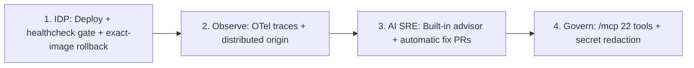

# Formatio Open-Source Failure Lab

[](https://opensource.org/licenses/MIT)
[](https://playground.formatio.cloud)
[](https://formatio.cloud/dashboard)

Reproducible production chaos, **3-service distributed trace cascades**, **Automatic Fix PR fixtures**, and a 5-minute evaluation harness across all four Formatio products: **IDP**, **Observability**, **AI SRE**, and **Govern**.

- **Try without signing in:** Explore a pre-loaded deploy, trace waterfall, AI SRE pull request, and Govern workspace in the [interactive playground](https://playground.formatio.cloud).
- **Run on your own infrastructure:** Start a **14-day free trial** (`$200/month flat` per organization afterwards, zero per-seat fees) at [Formatio Dashboard](https://formatio.cloud/dashboard).
- **Read full product guides:** [Formatio documentation](https://formatio.cloud/docs).

---

## Start here: the 5-minute Golden Loop



1. Fork this repository and deploy `apps/node-express` in [Formatio Dashboard](https://formatio.cloud/dashboard) (either select **`railpack.node.json`** from the repo root, OR set **Directory** to `apps/node-express` with Dockerfile).
2. Enable **Organization › AI › Automatic** + **Automatic fix PRs** (works natively out of the box, zero API keys needed) and **Settings › Tracing**.
3. Run the Golden Loop against your live service URL (or locally on `http://localhost:3000`):
   ```bash
   ./scripts/simulate.sh --golden-loop --target https://your-app.formatio.cloud
   ```
4. Inspect all 4 products in Formatio:
   - **IDP:** Verify `/healthz` readiness gating, `/data` volume persistence, and 1-click exact-image **Roll back** on **Deployments**.
   - **Observability:** Open **Tools › Traces** and **Tools › Errors** to see OTLP trace waterfalls with `formatio.deployment.id` / `service.version` release metadata and suspect commit ranking.
   - **AI SRE:** View the built-in **AI error advisor** diagnosis and the ready-to-review fix pull request opened on GitHub (`apps/node-express/discount.js` or `apps/go-gin/shipping_total.go`).
   - **Govern:** Query errors over `POST /mcp` (`22` tools + `fix_issue`, supporting account-wide tokens and live **Edit scopes**) to confirm secret values stay redacted to names only, then test the instant `agent_access` kill switch.

---

## 3-service distributed trace mesh (Railpack or Dockerfile)

Deploy **`node-express`**, **`go-gin`**, and **`python-fastapi`** into **one Formatio project** to run real cross-service OTel cascades (**Scenario 17** and **Scenario 18**) plus stock error-grouping routes (`/ok`, `/slow`, `/exception`, `/not-found/:id`, `/status-500`, `/crash`, `/downstream`):

| Application name | Port | Railpack config (repo root) | Dockerfile (folder / file) | Distributed mesh env vars |
| :--- | :---: | :--- | :--- | :--- |
| **`node-express`** | `3000` | `railpack.node.json` | `apps/node-express/Dockerfile` | `ORDERS_URL=http://go-gin:8080`, `GO_URL=http://go-gin:8080`, `DOWNSTREAM_URL=http://python-fastapi:8000` |
| **`go-gin`** | `8080` | `railpack.go.json` | `apps/go-gin/Dockerfile` | `PAYMENTS_URL=http://python-fastapi:8000`, `PYTHON_URL=http://python-fastapi:8000`, `DOWNSTREAM_URL=http://node-express:3000` |
| **`python-fastapi`** | `8000` | `railpack.python.json` | `apps/python-fastapi/Dockerfile` | `GO_URL=http://go-gin:8080`, `DOWNSTREAM_URL=http://go-gin:8080` |
| **`nextjs-15`** | `3000` | Auto-detected in folder | `apps/nextjs-15/Dockerfile` | Standalone Next.js 15 App Router + `@formatio/otel-next` |

---

## 4-track scenario catalog (18 scenarios)

Every scenario lives under [`scenarios/`](./scenarios) with an executable `trigger.sh` script, reproduction steps, and a `git apply`-verified `solution.patch`, workflow YAML, or verification checklist.

### Track 1 — IDP (deploy, roll back, persist and automate)

| ID | Scenario | Value proven | Dossier |
| :--- | :--- | :--- | :--- |
| **08** | **Bad release, healthcheck gate and rollback** | Blocks unhealthy `/healthz` or `127.0.0.1` releases before cutover; 1-click exact-image **Roll back** without rebuilding | [Scenario 08](./scenarios/08-bad-release-healthcheck-rollback) |
| **09** | **Persistent volume survival and web terminal** | Compares ephemeral `/tmp` reset vs. durable `/data` volume across redeploys, verified in browser **Terminal** | [Scenario 09](./scenarios/09-persistent-volume-and-terminal) |
| **10** | **Zero-CI deploy workflow and BuildKit secrets** | Replaces bespoke CI YAML with a branch/path DAG (`workflow.yaml`) and ephemeral `/run/secrets/<KEY>` builds | [Scenario 10](./scenarios/10-deploy-workflow-and-buildkit-secrets) |

### Track 2 — Observability (lightweight OpenTelemetry, distributed traces and alerts)

| ID | Scenario | Runtime | Value proven | Dossier |
| :--- | :--- | :--- | :--- | :--- |
| **01** | **Unbounded heap allocation (OOM kill)** | Node / Go / Python | Captures trace and memory context before kernel `SIGKILL (137)` | [Scenario 01](./scenarios/01-heap-oom-crash) |
| **02** | **Upstream connection starvation (15s hang)** | Node / Go / Python | Exposes latency outliers and reverse-proxy saturation cleanly | [Scenario 02](./scenarios/02-connection-starvation-hang) |
| **03** | **Detached async unhandled rejection** | Node.js | PID-1 OTLP crash flush records exit exceptions silently dropped after `202` | [Scenario 03](./scenarios/03-unhandled-promise-rejection) |
| **04** | **CPU starvation and event loop block** | Node.js | Pinpoints synchronous CPU loops freezing `/healthz` and concurrent I/O | [Scenario 04](./scenarios/04-event-loop-block) |
| **05** | **Database connection pool lockup** | Node / Python | Surfaces pool queue timeouts and contention inside span waterfalls | [Scenario 05](./scenarios/05-postgres-pool-lockup) |
| **06** | **Unbounded goroutine channel leak** | Go | Tracks leaked channel goroutines before GC stalls and OOM crashes | [Scenario 06](./scenarios/06-unbounded-goroutine-leak) |
| **07** | **Asyncio CPU starvation in ASGI** | Python | Flags blocking CPU loops inside `async def` FastAPI routes | [Scenario 07](./scenarios/07-asyncio-cpu-starvation) |
| **11** | **Railpack auto-OTel vs. Next.js 15 SDK and alerts** | Node / Next.js 15 | Compares stock OTel instrumentation vs. 1-line `@formatio/otel-next` + alert integrations | [Scenario 11](./scenarios/11-otel-paths-and-alerts) |
| **17** | **Distributed checkout cascade (`origin` isolation)** | Node -> Go -> Python | Swallowed frontend `PriceFormatError` crashes Python 2 hops away; traces mark JS `price cart` as `origin` | [Scenario 17](./scenarios/17-distributed-checkout-origin) |
| **18** | **Deep DB outage cascading to frontend** | Node -> Go -> Python -> Go | 3-hop `query rates-db` outage cascades to a frontend `TypeError`; waterfall marks Go `origin` | [Scenario 18](./scenarios/18-distributed-dashboard-cascade) |

### Track 3 — AI SRE (built-in error advisor, automatic fix PRs and runtime CVEs)

| ID | Scenario | Value proven | Dossier |
| :--- | :--- | :--- | :--- |
| **12** | **1-line regressions (`discount.js`, `shipping_total.go`)** | Suspect-commit ranking -> built-in AI error advisor -> automatic ready-to-review GitHub fix PR | [Scenario 12](./scenarios/12-regression-suspect-commit-pr) |
| **13** | **Live runtime CVE vs. Dependabot noise** | Separates active production `dependencies` from unused `--omit=dev` packages (`eslint`) | [Scenario 13](./scenarios/13-runtime-cve-vs-noise) |

### Track 4 — Govern (safe coding agents, secrets and team access)

| ID | Scenario | Value proven | Dossier |
| :--- | :--- | :--- | :--- |
| **14** | **`/mcp` debugging with secret redaction** | `POST /mcp` (`get_occurrence`, `get_application`) returns env **names only, zero plaintext values** | [Scenario 14](./scenarios/14-mcp-secret-redaction) |
| **15** | **Scoped `/mcp` permissions and kill switch** | Verifies all 5 scopes (`FixProposalsWrite`, `ApplicationsWrite`), account-wide tokens, live **Edit scopes**, and `agent_access` kill switch | [Scenario 15](./scenarios/15-mcp-scopes-and-kill-switch) |
| **16** | **Project boundaries, SSO and REST API idempotency** | Proves org vs. project isolation and `Idempotency-Key` safety across `/api/.../` | [Scenario 16](./scenarios/16-org-boundaries-sso-and-api) |

---

## Local quickstart

```bash
git clone https://github.com/ibrahim-enejy/formatio-failure-lab.git
cd formatio-failure-lab

# Start node-express (:3000), go-gin (:8080), python-fastapi (:8000), nextjs-15 (:3001)
docker compose up --build -d

# Run full 4-product Golden Loop
./scripts/simulate.sh --golden-loop --target http://localhost:3000

# Trigger 3-service distributed trace cascades (Scenarios 17 & 18)
./scripts/simulate.sh -s 17 --target http://localhost:3000
./scripts/simulate.sh -s 18 --target http://localhost:3000

# Trigger stock OTel grouping matrix (ok, slow, exception, not-found, status-500, crash, downstream)
./scripts/simulate.sh --otel-all --target http://localhost:3000
```
