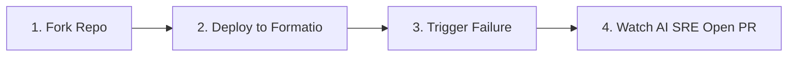

# Formatio Open-Source Failure Lab 🧪💥

[](https://formatio.cloud)
[](https://opensource.org/licenses/MIT)
[](#supported-frameworks--languages)

> **The Living Benchmark of Real-World Microservice Failures.**  
> Built to stress-test cloud infrastructure, observability pipelines, and autonomous remediation engines.

---

## ⚡ What is the Failure Lab?

Modern cloud production outages rarely resemble textbook bugs. They are emergent distributed failures: unhandled async rejections silently killing worker processes, slow upstream webhooks exhausting connection pools, event loops starved by CPU-heavy regexes, or unbounded goroutine leaks slowly pushing containers into cgroup OOM crashes.

The **Formatio Failure Lab** is an open-source, multi-framework benchmark repository where every failure is:
1. **100% Real-World Reproducible:** Injectable via a single cURL command or CLI script.
2. **Observable via OpenTelemetry:** Ready out of the box with runtime telemetry endpoints (`/api/lab/status`).
3. **Paired with Autonomous Remediation Blueprints:** Every scenario includes a root cause dossier and a verified `solution.patch` showing how an Autonomous SRE diagnoses and fixes the bug.

This repository serves as the **Shared Core Artifact** behind Formatio's weekly technical deep dives, architectural teardowns, and engineering benchmarks.

---

## 🏗️ Architecture & Framework Support

The repository is modularly sectioned by runtime and framework under [`apps/`](./apps):

| Framework / Language | Path | Key Outage Patterns Tested | Formatio Telemetry |
| :--- | :--- | :--- | :--- |
| **Node.js / Express** | [`apps/node-express`](./apps/node-express) | Heap OOM, Event loop freeze, Unhandled promise rejection, Prisma pool starvation | V8 Heap, Event loop lag, HTTP spans |
| **Python / FastAPI** | [`apps/python-fastapi`](./apps/python-fastapi) | Asyncio event-loop block, GIL contention, DB connection starvation | Python RSS/VMS, ASGI latency |
| **Go / Gin** | [`apps/go-gin`](./apps/go-gin) | Leaked goroutines, Unbuffered channel deadlocks, Heap allocation spikes | `runtime.NumGoroutine`, GC pause times |
| **Java / Spring Boot** | [`apps/java-spring`](./apps/java-spring) | JVM Metaspace leaks, Stop-The-World GC stalls, HikariCP exhaustion | JVM Heap/Metaspace, Thread pool |
| **Rust / Actix-Web** | [`apps/rust-actix`](./apps/rust-actix) | Tokio worker starvation, Async mutex deadlocks | Memory usage, Queue latency |

---

## 📂 Scenario Catalog

Granular reproduction dossiers, trigger scripts, and solution patches live under [`scenarios/`](./scenarios):

| ID | Scenario | Runtime | Failure Type | Reproduction Dossier |
| :--- | :--- | :--- | :--- | :--- |
| **01** | **Unbounded Heap Allocation (OOM)** | Node / Python / Go | Memory Exhaustion | [Dossier](./scenarios/01-heap-oom-crash) |
| **02** | **Upstream Connection Starvation (Hanging Webhook)** | All | Latency Cascade & Socket Exhaustion | [Dossier](./scenarios/02-connection-starvation-hang) |
| **03** | **Detached Async Unhandled Rejection** | Node.js | Uncaught Exception / V8 Exit Code 1 | [Dossier](./scenarios/03-unhandled-promise-rejection) |
| **04** | **CPU Starvation & Event Loop Blocking** | Node.js | Single-Thread Execution Starvation | [Dossier](./scenarios/04-event-loop-block) |
| **05** | **Database Connection Pool Lockup (N+1)** | Node / Python | Connection Pool Saturation | [Dossier](./scenarios/05-postgres-pool-lockup) |
| **06** | **Unbounded Goroutine Starvation** | Go | Concurrency / Goroutine Leak | [Dossier](./scenarios/06-unbounded-goroutine-leak) |
| **07** | **Asyncio CPU Starvation (Sync in ASGI)** | Python | Event Loop Freeze & Heartbeat Timeout | [Dossier](./scenarios/07-asyncio-cpu-starvation) |

---

## 🚀 How to Deploy & Test on Formatio

You can deploy any application from this lab directly to [Formatio](https://formatio.cloud) in less than 60 seconds:



1. **Fork this repository** to your personal GitHub account.
2. Log in to the [Formatio Cloud Dashboard](https://formatio.cloud/dashboard).
3. Click **New Service** → select your forked repository.
4. Set the **Root Directory** to your chosen app:
   - For Node.js: `apps/node-express`
   - For Python: `apps/python-fastapi`
   - For Go: `apps/go-gin`
5. Click **Deploy**. Formatio Railpack automatically builds and instruments the service.
6. Once deployed, run any scenario against your live production URL:
   ```bash
   ./scripts/simulate.sh --scenario 01-heap-oom-crash --target https://your-service.formatio.cloud
   ```
7. Watch the Formatio Autonomous SRE dashboard detect the anomaly, correlate the telemetry, and open an automated fix Pull Request on your repository.

---

## 💻 Local Quickstart

Want to experiment locally with Docker Compose?

```bash
# Clone the repository
git clone https://github.com/ibrahim-enejy/formatio-failure-lab.git
cd formatio-failure-lab

# Start all microservices and Postgres
docker compose up -d

# Verify live telemetry
curl -s http://localhost:3000/api/lab/status | jq .
curl -s http://localhost:8000/api/lab/status | jq .
curl -s http://localhost:8080/api/lab/status | jq .
```

### Running Scenarios with the Universal Simulator

```bash
# List all available scenarios
./scripts/simulate.sh --list

# Trigger Heap OOM on Node.js
./scripts/simulate.sh --scenario 01 --target http://localhost:3000

# Trigger Goroutine Leak on Go
./scripts/simulate.sh --scenario 06 --target http://localhost:8080

# Trigger Asyncio Event Loop Freeze on Python
./scripts/simulate.sh --scenario 07 --target http://localhost:8000
```

---

## 🛡️ Traditional APM vs. Formatio Autonomous SRE

| Metric / Action | Traditional APM (Datadog + PagerDuty) | Formatio Autonomous SRE |
| :--- | :--- | :--- |
| **Alert Delay** | 5 – 15 minutes (threshold aggregations) | Instantaneous OpenTelemetry span anomaly correlation |
| **Root Cause Isolation** | Manual log parsing & distributed trace diving | Code-level stack frame & commit correlation |
| **Remediation Time** | Hours to days of developer fire-fighting | Autonomous Pull Request opened in minutes with regression test |
| **Human Burden** | SRE woke up at 3:00 AM | Verified patch waiting in GitHub PR queue |

---

## 🤝 Contributing

We welcome community-contributed failure scenarios! If you have encountered an elusive production bug in your stack, please open a PR:

1. Place your scenario under `scenarios/XX-scenario-name/`.
2. Provide a `README.md` with Failure Anatomy, Reproduction, and Comparison table.
3. Provide a `trigger.sh` script and a `solution.patch`.

---

## 📄 License

Distributed under the MIT License. See [LICENSE](./LICENSE) for details.
