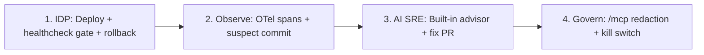

# Formatio Open-Source Failure Lab

[](https://opensource.org/licenses/MIT)
[](https://playground.formatio.cloud)
[](https://formatio.cloud/dashboard)

Reproducible production chaos and quickfire evaluation harness across all four Formatio products: **IDP**, **Observability**, **AI SRE**, and **Govern**.

- **Try without signing in:** Explore a pre-loaded deploy, trace waterfall, AI SRE pull request, and Govern workspace in the [interactive playground](https://playground.formatio.cloud).
- **Run on your own servers or clusters:** Start a **14-day free trial** (`$200/month flat` per organization afterwards, zero per-seat fees) at [Formatio Dashboard](https://formatio.cloud/dashboard).
- **Read full product guides:** [Formatio documentation](https://formatio.cloud/docs).

---

## Start here: the 5-minute Golden Loop

See all four Formatio pillars working together in a single guided run:



1. Fork this repository and deploy `apps/node-express` in [Formatio Dashboard](https://formatio.cloud/dashboard) (**New application** → set **Directory** to `apps/node-express` → **Deploy**).
2. Enable AI triage on **Organization › AI** (keep **Provider** on **Automatic** — Formatio's built-in AI error advisor works out of the box with zero API keys required).
3. Run the Golden Loop against your live service URL (or locally on `http://localhost:3000`):
   ```bash
   ./scripts/simulate.sh --golden-loop --target https://your-app.formatio.cloud
   ```
4. Inspect each product tab in Formatio:
   - **IDP:** Verify `/healthz` readiness gating, `/data` volume persistence, and 1-click **Rollback** on **Deployments**.
   - **Observability:** Open **Tools › Traces** and **Tools › Errors** to see the correlated OTLP waterfall and suspect commit ranking.
   - **AI SRE:** View the built-in **AI error advisor** diagnosis and the human-reviewed fix pull request opened on your Git repo (never pushing directly to `main`).
   - **Govern:** Query your errors over `POST /mcp` (`FORMATIO_MCP_TOKEN`) to confirm secret values stay redacted to names only, then test the instant `agent_access` kill switch.

---

## 4-track scenario catalog

Every scenario lives under [`scenarios/`](./scenarios) with an executable `trigger.sh` script, reproduction steps, and a `git apply`-verified `solution.patch`, workflow YAML, or verification checklist.

### Track 1 — IDP (deploy, roll back, persist and automate)

| ID | Scenario | Value proven | Dossier |
| :--- | :--- | :--- | :--- |
| **08** | **Bad release, healthcheck gate and rollback** | Blocks unhealthy `/healthz` or `127.0.0.1` releases before traffic cutover; 1-click **Rollback** to prior commit SHA | [Scenario 08](./scenarios/08-bad-release-healthcheck-rollback) |
| **09** | **Persistent volume survival and web terminal** | Compares ephemeral `/tmp` reset vs. durable `/data` volume across redeploys, verified in browser **Terminal** | [Scenario 09](./scenarios/09-persistent-volume-and-terminal) |
| **10** | **Zero-CI deploy workflow and BuildKit secrets** | Replaces bespoke CI YAML with a branch/path DAG (`workflow.yaml`) and ephemeral `/run/secrets/<KEY>` builds | [Scenario 10](./scenarios/10-deploy-workflow-and-buildkit-secrets) |

### Track 2 — Observability (lightweight OpenTelemetry, traces and alerts)

| ID | Scenario | Runtime | Value proven | Dossier |
| :--- | :--- | :--- | :--- | :--- |
| **01** | **Unbounded heap allocation (OOM kill)** | Node / Python / Go | Captures trace and memory context before kernel `SIGKILL (137)` | [Scenario 01](./scenarios/01-heap-oom-crash) |
| **02** | **Upstream connection starvation (15s hang)** | Node / Go | Exposes latency outliers and reverse-proxy saturation cleanly | [Scenario 02](./scenarios/02-connection-starvation-hang) |
| **03** | **Detached async unhandled rejection** | Node.js | 2-second OTLP crash flush records exit exceptions silently dropped after `202` | [Scenario 03](./scenarios/03-unhandled-promise-rejection) |
| **04** | **CPU starvation and event loop block** | Node.js | Pinpoints synchronous CPU loops freezing `/healthz` and concurrent I/O | [Scenario 04](./scenarios/04-event-loop-block) |
| **05** | **Database connection pool lockup** | Node / Python | Surfaces pool queue timeouts and N+1 contention inside span waterfalls | [Scenario 05](./scenarios/05-postgres-pool-lockup) |
| **06** | **Unbounded goroutine channel leak** | Go | Tracks leaked channel goroutines before GC stalls and OOM crashes | [Scenario 06](./scenarios/06-unbounded-goroutine-leak) |
| **07** | **Asyncio CPU starvation in ASGI** | Python | Flags blocking CPU loops inside `async def` FastAPI routes | [Scenario 07](./scenarios/07-asyncio-cpu-starvation) |
| **11** | **Railpack auto-OTel vs. Next.js 15 SDK and alerts** | Node / Next.js 15 | Compares automatic Railpack OTel vs. 1-line `@formatio/otel-next` + 6 alert integrations | [Scenario 11](./scenarios/11-otel-paths-and-alerts) |

### Track 3 — AI SRE (built-in error advisor, fix PRs and runtime CVEs)

| ID | Scenario | Value proven | Dossier |
| :--- | :--- | :--- | :--- |
| **12** | **1-line regression, built-in advisor and fix PR** | Suspect-commit ranking → built-in **AI error advisor** (works natively out of the box; optional BYO across 7 providers) → human-reviewed fix PR | [Scenario 12](./scenarios/12-regression-suspect-commit-pr) |
| **13** | **Live runtime CVE vs. Dependabot noise** | Focuses remediation on actively running dependencies rather than flooding PR queues with unused `devDependencies` | [Scenario 13](./scenarios/13-runtime-cve-vs-noise) |

### Track 4 — Govern (safe coding agents, secrets and team access)

| ID | Scenario | Value proven | Dossier |
| :--- | :--- | :--- | :--- |
| **14** | **`/mcp` debugging with secret redaction** | Cursor / Claude Code calls `POST /mcp` (`get_occurrence`, `get_application`) and receives env **names only, zero values** | [Scenario 14](./scenarios/14-mcp-secret-redaction) |
| **15** | **Scoped `/mcp` permissions and kill switch** | Verifies read-only vs. deploy scopes and instant organization `agent_access` revocation | [Scenario 15](./scenarios/15-mcp-scopes-and-kill-switch) |
| **16** | **Project boundaries, SSO and REST API idempotency** | Proves org vs. project isolation, included OIDC/SAML SSO, and `Idempotency-Key` protection across `/api/.../` | [Scenario 16](./scenarios/16-org-boundaries-sso-and-api) |

---

## Applications and framework matrix

| Service | Directory | Status | OpenTelemetry instrumentation path |
| :--- | :--- | :--- | :--- |
| **Node.js / Express** | [`apps/node-express`](./apps/node-express) | **Runnable** | Automatic `@formatio/otel-node` preload on Railpack builds |
| **Next.js 15 (App Router)** | [`apps/nextjs-15`](./apps/nextjs-15) | **Runnable** | 1-line `src/instrumentation.ts` (`@formatio/otel-next`) |
| **Python / FastAPI** | [`apps/python-fastapi`](./apps/python-fastapi) | **Runnable** | Automatic `formatio-otel` startup preload on Railpack builds |
| **Go / Gin** | [`apps/go-gin`](./apps/go-gin) | **Runnable** | Automatic Go compile-time OTel on Railpack builds |
| **Java / Spring Boot** | [`apps/java-spring`](./apps/java-spring) | Template stub | Java agent roadmap documented in folder README |
| **Rust / Actix-Web** | [`apps/rust-actix`](./apps/rust-actix) | Template stub | Custom OTLP export notes documented in folder README |

---

## Deploy to Formatio in 60 seconds

1. Fork this repository to your GitHub, GitLab, Bitbucket, or Azure DevOps account.
2. Open [Formatio Dashboard](https://formatio.cloud/dashboard) (`14-day free trial` across all four products on your own servers, Docker Swarm, Kubernetes, AWS ECS, or Google Cloud Run).
3. Click **New application** and select your forked `formatio-failure-lab` repository.
4. Set **Directory** to the service you want to test:
   - `apps/node-express` (port `3000`)
   - `apps/nextjs-15` (port `3000`)
   - `apps/python-fastapi` (port `8000`)
   - `apps/go-gin` (port `8080`)
5. Click **Deploy**, turn on **Organization › AI** (keep **Provider** on **Automatic** for Formatio's built-in AI model, or optionally attach your own across 7 backends), and run `./scripts/simulate.sh`.

---

## Local quickstart

```bash
git clone https://github.com/ibrahim-enejy/formatio-failure-lab.git
cd formatio-failure-lab

# Start Postgres, node-express (:3000), nextjs-15 (:3001), python-fastapi (:8000), go-gin (:8080)
docker compose up -d

# List scenarios by track
./scripts/simulate.sh --list
./scripts/simulate.sh --track idp
./scripts/simulate.sh --track govern

# Run the 5-minute Golden Loop against local Node/Express
./scripts/simulate.sh --golden-loop --target http://localhost:3000
```

---

## Stitched tooling vs. Formatio

| Workflow step | Separate CI + PaaS + APM + chat bots | Formatio |
| :--- | :--- | :--- |
| **Deploy & roll back** | Hand-rolled CI scripts and manual cluster rollbacks | Git deploy onto your own infra, `/healthz` gating, and 1-click commit rollback |
| **Instrumentation** | Collector sidecars or multi-week manual wiring | Automatic Railpack OTel (`Go`, `Node.js`, `Python`, `Java`, `.NET`) or 1–3 line SDK hook |
| **Diagnosis & fix PRs** | Copy stack traces into chat or buy separate AI add-ons | Built-in AI error advisor out of the box (optional 7-provider BYO) + sandboxed reviewed fix PRs |
| **Coding-agent security** | Pasting `.env` files or sharing broad PATs | Expiring scoped `/mcp` tokens showing secret **names only** + `agent_access` kill switch |
| **Pricing & SSO** | Per-seat, per-GB ingest, and Enterprise SSO upsells | **$200/month flat** per organization including OIDC/SAML SSO (14-day free trial) |

---

## Contributing

Pull requests adding realistic failure scenarios under `scenarios/XX-scenario-name/` (`README.md`, executable `trigger.sh`, and `solution.patch`) are welcome. Keep scenario headings in strict sentence case without emojis or fabricated benchmark numbers.

## License

Distributed under the MIT License. See [`LICENSE`](./LICENSE) for details.
